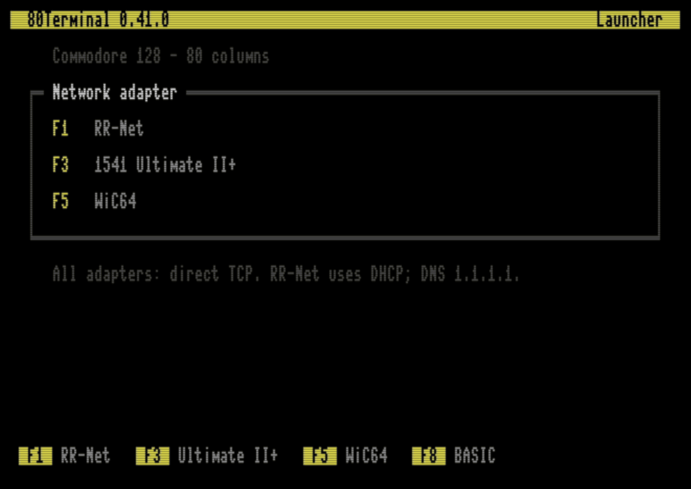
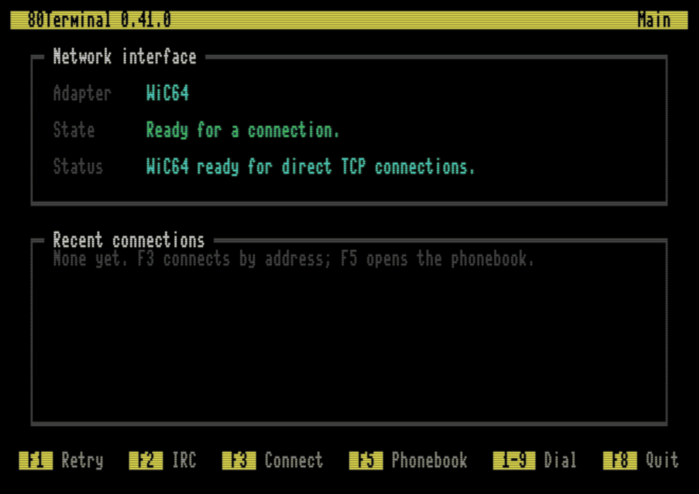
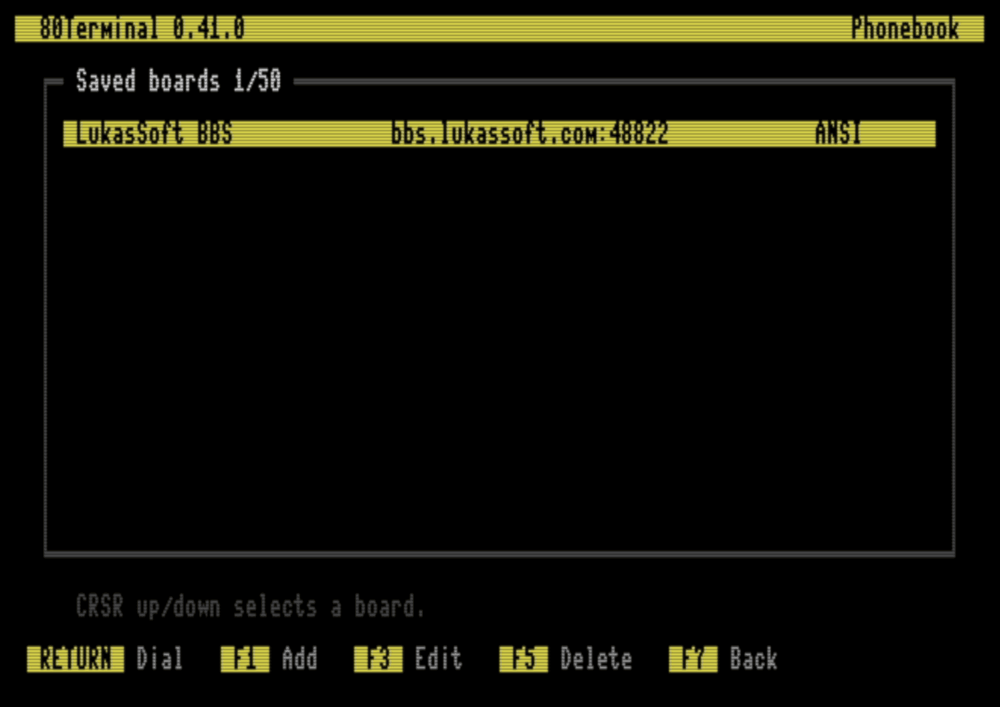

# 80Terminal

Oscar64 terminal for the Commodore 128's 80-column display. The launcher loads
one network adapter at a time: WiC64, Ultimate II+, or RR-Net.



Device selection is a one-time launch step: F1 RR-Net, F3 Ultimate II+,
F5 WiC64, F8 back to BASIC. The selected adapter stays loaded while the main
screen owns connections: F1 retries interface initialization, F2 opens IRC,
F3 connects by address, F5 opens the phonebook, keys 1-9 dial a recent
connection, and F8 exits to BASIC. Cancelling or disconnecting returns to the main screen, after
a summary of the session.



## IRC

**F2** on the main screen opens the IRC client, on the same adapter as the
terminal. Enter the server, port, your nickname and the channels to join
(`#one,#two`, or none); the settings are kept in a small text file, `irc`,
on the program disk. There is no default nickname, so that users do not
all arrive under the same one.

- **Plain IRC only.** No adapter offers TLS, so use a server's plain port,
  usually 6667. Do not send passwords: there is no NickServ or SASL login.
- **Windows:** the Server window and up to four channels or private
  conversations, shown as tabs under the title. A tab turns white when
  there is something new, and amber for a private message or your nickname.
- **Keys:** RETURN sends, F1 next window, F3 closes the window (leaving a
  channel), F5 lists the channel's names, F7 disconnects.
- **Commands:** `/join #channel [key]`, `/part`, `/names`, `/nick name`,
  `/msg name text`, `/query name`, `/me action`, `/quit`, `/help`. Text that
  starts with a slash is sent with `//`.
- **Text:** ASCII. Accented letters and emoji are shown as `?`, and mIRC
  colours and styles are removed.
- Each window shows its last 20 rows; there is no scrollback. People
  quitting or changing nickname are shown in the channel when exactly one
  is joined, otherwise in the Server window, because the client keeps no
  member lists.

The IRC client has host and 6502 tests against a scripted server. It has
not been run on real hardware yet.

## Phonebook

The phonebook holds up to 50 boards: F1 adds, F3 edits, F5 deletes, RETURN
dials, and the cursor keys select. The nine most recent connections are
listed on the main screen. Both are plain ASCII text files on the boot disk,
`phonebook` and `recent`, so a phonebook can be shared on a BBS, downloaded
to another disk, or edited on any computer:



```
80TPB 1
# comment lines start with #
LukasSoft BBS|bbs.lukassoft.com|48822|ansi80
```

Each line is `name|host|port|mode`, with CR, LF or CRLF line endings. Modes
are `petscii80`, `ansi80`, `vt100`, `ansi80mono`, `vt100mono` and `amiga80`;
`petscii40` and `ascii80` (as ANSI mono) from the 80Terminal mobile app are
read as their nearest 80-column mode, and
other modes are skipped for now. Names are up to 24 characters and hosts up to 64.
Fields after the mode are ignored, so later versions can add some. Saving
writes `phonebook.new` first and then replaces `phonebook`, so a full disk
never loses the previous file; comments are not kept when the C128 saves.
Recent connections are a separate file, so sharing a phonebook never shares
call history. The disk image starts with `assets/phonebook.txt`.

## File transfers

Press **HELP** during a session to transfer files; the connection stays
open, and F7 returns to the same terminal screen. Start the transfer on the
BBS first, then choose it on the C128:

- **F1 Download:** XMODEM. CRC, checksum and 1K blocks are detected from
  the sender. Enter the file name, choose PRG, SEQ or USR, and the drive
  (8-30). XMODEM carries no name or exact size, so the file ends with the
  sender's padding. An existing file is replaced only after **Y**.
- **F3 Upload:** pick a PRG, SEQ or USR file from the drive's directory,
  then XMODEM (128-byte blocks) or XMODEM-1K.

Each block is acknowledged only once it is on disk, so a slow drive simply
pauses the sender. F7 or RUN/STOP cancels; a partial download is kept.
Telnet binary mode is requested for the transfer; when a board does not
agree, CR NUL handling keeps every byte intact. ZMODEM is planned.

`tests/transfer_test.c` runs these transfers against `lsz`/`lrz` (lrzsz)
through a Telnet stand-in, with and without binary mode; `make test` runs it
when lrzsz is installed.

## Current baseline

All three adapters—WiC64, 1541 Ultimate II+, and RR-Net—are confirmed working
on real C128 hardware by user validation on 2026-09-27, including terminal
connections, disconnecting and reconnecting. The latest VIC blanking and
F7 disconnect / Ctrl-C passthrough changes were also validated on hardware.
WiC64 was previously verified with firmware 2.1.0.

After entering the host and port, choose one of six 80-column terminal profiles:

| Key | Mode | Size | Telnet terminal type |
| --- | --- | --- | --- |
| 1 | ANSI, with CP437 graphics and colors | 80x25 | `ANSI` |
| 2 | Native PETSCII | 80x25 | `C128` |
| 3 | VT100, with DEC special graphics | 80x24 | `VT100` |
| 4 | ANSI mono: ANSI on a monochrome display | 80x25 | `ANSI` |
| 5 | VT100 mono: VT100 on a monochrome display | 80x24 | `VT100` |
| 6 | Amiga ANSI, with the Topaz 8 font and Latin-1 | 80x25 | `ANSI` |

There is no 40-column PETSCII mode. ANSI, VT100 and Amiga share the VDC
renderer. ANSI and VT100 use the CP437 font; Amiga uses Topaz 8 (`topazfont`
on the disk). Only the font a session needs is loaded from disk, and bank 1
keeps a copy of the last one, so switching between ANSI and Amiga reads the
other font again. VT100 follows the original `80Terminal_cc65` mode, with G0/G1
character-set designation and SI/SO switching, scroll margins, origin mode,
reverse index, configurable tab stops, saved cursor/rendition state, and
application cursor keys. Both modes support editing controls and terminal
identification/status replies. VT100 leaves the physical 25th row blank and
reports 80x24 through Telnet NAWS.

The Amiga profile follows the Flutter app's `amiga80`: Latin-1 text in
Topaz, with C1 bytes `$80`-`$9F` never drawn. It accepts single-byte CSI (`$9B`) as
well as `ESC [`. Newline mode is on (LF also returns the carriage, and
`ESC[20l` turns that off), VT moves the cursor up and FF clears the screen.
`CSI n u` (the Amiga line length) is ignored, while a bare `CSI u` still
restores the cursor. Keys send Amiga console codes: cursor keys `CSI A`-`D`,
F1-F6 and F8 `CSI 0~`-`CSI 7~`, CLR/HOME `CSI 44~`, DEL as backspace and
RETURN as CR alone. F7 and HELP stay local. Amiga colour pens, italics and
window-bound reports are not emulated.

The mono profiles are display variants: the host negotiates ANSI or VT100
exactly as for the colour profile. The profile is chosen per connection and
saved with each phonebook and recent entry (`ansi80mono`, `vt100mono`).
Monochrome uses fixed white-on-black text, retains CP437 and DEC graphics,
and ignores per-character colour, bold, reverse, underline and blink. It
writes only character memory, batches printable runs through VDC
autoincrement, and scrolls and clears without attribute-memory traffic. File
transfers return to the same display mode and terminal screen.

The separate terminal choices and expanded parser have host and 6502 tests;
they were added after the adapter hardware validation recorded above.
RR-Net implements DHCP with lease renewal, DNS lookup and one TCP client stream.
RR-Net DHCP, DNS and TCP/Telnet operation are validated on hardware.
Shared Telnet, XMODEM and phonebook cores have tests.

During a session, **F7 disconnects** and **Ctrl-C goes to the host**. RUN/STOP
also sends byte 3 (the KERNAL reports the same code for both keys).
The socket closes before the session summary shows key and TCP byte counts.
Press any key to return to the main screen, then **F3** for a new connection;
there is no suspended session to resume. **F1** retries a failed interface.
The VIC display stays blank during operation at 2 MHz, including temporary
1 MHz cartridge accesses, and its display setting is restored on exit.

The screens and the session take turns in one slot at `$3800-$5fff`, as
five overlays: `uimain` (launcher, main screen, connect form, IRC server
form, summary), `uibook` (phonebook and recent connections), `uiterm`
(connection, Telnet session and the ANSI/VT100/PETSCII terminal), `uixfer`
(file transfers) and `uiirc` (IRC chat). Each is loaded from
disk once and kept in C128 RAM bank 1 at its real length; later switches
copy it back with the KERNAL's INDFET routine. Bank 1 also holds the
phonebook, recent list, CP437 font, the terminal screen during a
transfer, and the rows of the IRC windows. The resident program (platform, adapters' interface, Telnet,
disk access, overlay loader) ends near `$3740`; its variables use the free
`$1300-$1bff` area, the overlays' variables `$0b00-$0fff`, and the
transfer and IRC overlays' the unused VIC text screen at `$0400`. The
memory map is in `include/memory_map.h` and `include/bank1.h`.

Adapter buffers share the reserved `$6000-$7fff` RAM area. Ultimate's buffers
use this area alongside the existing RR-Net/WiC64 alternatives, leaving room
for the shared terminal parser. Only the selected adapter uses these buffers;
they are excluded from disk overlays so loading cannot overwrite the stack.

## Ultimate initialization

`make` creates the distributable disk image at `build/terminal80.d64`.
For the C128 workflow, enable **Command Interface** under **C64 and Cartridge
Settings** in the Ultimate menu before mounting the disk. Ultimate's **Run
Disk** action launches C64 mode, so its per-title CFG mechanism is not used by
this C128 program.
See the firmware's
[Run Disk implementation](https://github.com/GideonZ/1541ultimate/blob/master/software/filetypes/filetype_d64.cc)
and [mount implementation](https://github.com/GideonZ/1541ultimate/blob/master/software/drive/c1541.cc).

80Terminal is a disk-loaded C128 program. The launcher, adapters and font stay
inside the D64. Its configuration is separate from the program's IO2 network
check.

80Terminal detects UCI through IO2 at `$DF1D`, then resets the interface and
checks network identification and the IP address. It does not attempt the
VIC-space `$D038`/`$D036` software unlock on the C128. If detection fails,
enable the interface in the Ultimate menu and press **F1** to retry.

## Build

RR-Net initialization requests an address, subnet mask and gateway via DHCP.
DNS is overridden to `1.1.1.1` after each accepted lease. The status line shows
the assigned IP, or reports a timeout after 60 seconds with sent, received
Ethernet-frame and DHCP-reply counts. F1 retries. Lease timers run during menu
and input waits. DHCP and terminal connections are validated on
the real adapter.
Connections accept a hostname or dotted IPv4 address. The TCP client uses a
536-byte MSS, a 2 KB receive queue, retransmission and flow control.

Install Oscar64, ACME and VICE's `c1541`. `make` uses `oscar64` from PATH, or
falls back to `$OSCAR64_HOME/bin/oscar64` (default `~/Developer/oscar64`). The
pinned compiler revision is recorded in `tools/oscar64-revision.txt`.

```
make all test test-oscar test-vice
```

`make test-vice` boots a copy of the disk in x128 and checks the launcher,
the bank-1 overlay copies, the phonebook (adding a board and the saved text
file), and the exit to BASIC. `python3 tests/vice_smoke.py --screenshots`
also saves the screens to `build/screens/`.

Boot `build/terminal80.d64` in C128 mode. Keep the adapter files on the disk.
`make run` starts VICE in 80-column mode. CPU tests do not emulate WiC64 hardware.

The official WiC64 assembly library is vendored under `third_party/wic64`, with
its license. Local reference projects, toolchains and build output are excluded
from version control.
